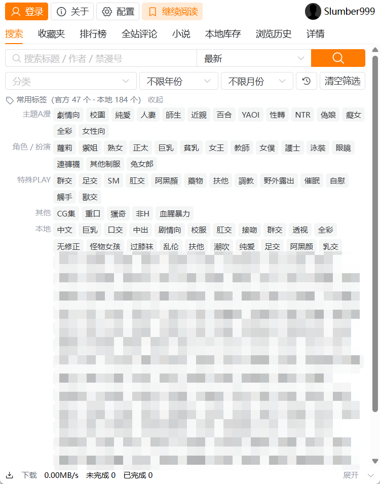
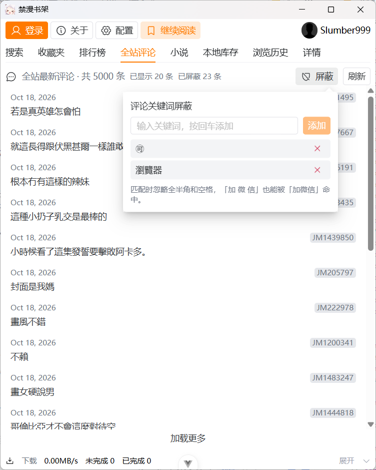

<div align="center">


# 禁漫书架 · JMComic Shelf

禁漫天堂（JMComic / 18comic）客户端 · 桌面与安卓
搜索 · 下载 · 任务管理 · 本地书库 · 内置阅读器

</div>

<p align="center">
  <a href="https://github.com/Slumber999/JMComic-Shelf/releases"></a>
  
  
  
  
  
</p>

## 功能

### 发现与检索

- **搜索**：关键词搜索，支持最新、点击、图片、爱心四种排序
- **搜索增强**：官方分类树、官方常用标签、多标签累加搜索、年月筛选、搜索历史
- **多关键词搜索**：搜索框右侧开关，开启后多个关键词按标签取精确交集（更慢但更准）
- **排行榜**：官方总榜 / 月榜 / 周榜 / 日榜，可按全部、同人、单本、短篇、其他、韩漫筛选
- **每周连载**：按星期查看官方连载更新，可切换全部 / 日漫 / 韩漫
- **收藏夹**：登录后浏览收藏夹，多选 / 全选 / 点选 / 跨页保留，批量下载或批量导出 cbz
- **收藏夹搜索**：官方未提供接口，本地索引实现，按标题、作者、禁漫号过滤，零请求，瞬间搜索
- **收藏夹标签筛选**：展开标签抽屉选标签（可多选），用本地索引精确筛选
- **本地分组**：将收藏夹中一本或多本漫画创建分组，不影响收藏夹，纯本地
- **全站评论**：浏览全站最新评论，点击跳转到对应漫画的详情页
- **本地库存**：下载目录 / 导出目录两种来源切换，标签筛选
- **本地标签云**：纯离线聚合已下载漫画的标签，点标签即按它搜索，或在本地库存里筛选
- **作者收藏**：详情页作者名后可收藏作者，收藏的作者进入本地标签体系，可快捷搜索或筛本地库存
- **浏览历史**：官方保留的近 20 条观看记录
- **评论屏蔽**：按关键词屏蔽广告评论，支持全角/空格归一化匹配

### 下载与任务管理

- **多线程下载**：图片并发下载，失败自动重试
- **图片格式**：jpg 或 png
- **暂停 / 继续**：下载与导出任务都能暂停、继续；暂停在图片 / 章节边界生效
- **任务持久化**：关闭软件时自动全部暂停，重启后在进度抽屉里手动继续
- **进度抽屉**：底部常驻状态栏 + 可展开的下载 / 导出进度面板，支持框选后批量操作

### 导出与分享

- **导出 cbz / pdf**：把已下载的漫画打包成单文件
- **免下载直出 cbz**：图片在内存里取回、还原拼图后直接打包，不落下载目录，带图片级进度
- **跳过已存在**：继续导出时自动跳过已经导好的章节
- **快速阅读器**：导出成自包含的 HTML 分享包，离线可看，方便直接分享

### 阅读

- **内置阅读器**：本地图片 / cbz / 漫画在线阅读，单页与滚动两种模式
- **连续阅读**：上一章 / 下一章、阅读进度记忆、漫画宽度调节
- **评论**：在阅读页或详情页查看当前漫画 / 小说的评论
- **预加载与缓存**：图片级预加载 + 内存缓存，翻页不卡

### 小说

- **小说列表与搜索**：顶部「小说」页签，支持按标题 / 作者搜索
- **正文阅读**：复用阅读器，按段落排版、上下章翻页、宽度调节，并记忆阅读位置
- **小说评论**：详情页可查看当前小说的评论

### 界面与配置

- **列表 / 网格视图**：漫画列表可切换列表或网格
- **封面悬停预览**：列表模式下鼠标放到封面上，侧边贴出放大 2~3 倍的预览图，倍数可在设置里调节
- **线路优化**：API 线路一键测速并选最快；图片线路失败自动切换
- **空间统计与清理**：统计下载 / 导出 / 日志占用，清理下载残留、分享包、旧日志
- **语言**：适配简体中文 / 繁体中文
- **配置分区**：账号、下载、导出、网络、空间、界面
- **每日签到**：登录后头像左侧出现签到按钮，当日已签到则自动隐藏

## 界面截图

| **搜索** | **收藏夹** |
| :---: | :---: |
| [](docs/搜索.png) | [](docs/收藏夹.png) |
| 关键词 + 标签，码中为本地标签云 | 搜索、批量下载或导出 cbz、一键同步收藏夹 |

| **排行榜** | **全站评论** |
| :---: | :---: |
| [](docs/排行榜.png) | [](docs/全站评论.png) |
| 完整的官方排行榜 | 全站最新评论，点击跳到对应漫画的详情页 |

| **每周连载** | **小说列表** |
| :---: | :---: |
| [](docs/每周连载.png) | [](docs/小说.png) |
| 按星期浏览官方连载更新，可切换全部 / 日漫 / 韩漫 | 顶部「小说」页签，包含搜索与网格浏览 |

| **本地库存** | **评论屏蔽** |
| :---: | :---: |
| [](docs/本地库存.png) | [](docs/屏蔽词.png) |
| 下载与导出两个目录，本地封面与标签云 | 按关键词屏蔽广告评论，可自行添加屏蔽词，如“瀏覽器"、”🉑“等特殊词 |

## 安卓端

[](docs/安卓.png)

四个界面并列：搜索与标签云、收藏夹、本地库存、全站评论。

## 下载

前往 [Releases](https://github.com/Slumber999/JMComic-Shelf/releases) 下载：

- **Windows**：免安装单文件 exe，双击即可运行，需要系统自带 WebView2（Windows 10 / 11 一般都有）
- **Android**：arm64 APK，直接安装即可（首次安装需允许「未知来源」）

两端功能基本一致。作者尚未在 macOS / iOS 等其他系统验证，代码本身不受系统限制，需要请自行构建。

## 构建

需要 [Rust](https://www.rust-lang.org/tools/install)、[Node](https://nodejs.org/en)、[pnpm](https://pnpm.io/installation)。

```bash
git clone https://github.com/Slumber999/JMComic-Shelf.git
cd JMComic-Shelf
pnpm install

# 开发模式（改前端热更新）
pnpm tauri dev

# 打包：exe + NSIS 安装包
pnpm tauri build --bundles nsis

# 只想要免安装 exe，不打安装包（产物在 src-tauri/target/release/）
pnpm build
pnpm tauri build --no-bundle
```

### macOS 打包

需要 macOS 与 Xcode Command Line Tools（`xcode-select --install`）。

```bash
# Apple Silicon（M 系列）
pnpm tauri build --target aarch64-apple-darwin

# Intel 机型
pnpm tauri build --target x86_64-apple-darwin

# 通用包（两种芯片都能跑，需先装两个 target）
rustup target add aarch64-apple-darwin x86_64-apple-darwin
pnpm tauri build --target universal-apple-darwin
```

产物在 `src-tauri/target/<target>/release/bundle/dmg/*.dmg`。

## 反馈与贡献

- Bug、功能建议：欢迎开 issue
- 想要上游原版的功能或问题反馈，请去 [原仓库](https://github.com/lanyeeee/jmcomic-downloader)

## 免责声明

- 本工具仅供学习、研究、交流使用，请勿用于商业用途
- 使用者应自行承担使用风险；作者不对使用本工具造成的任何损失、法律纠纷或其他后果负责
- 请遵守你所在地区的法律法规，支持正版

## Star History

<a href="https://www.star-history.com/?repos=Slumber999%2FJMComic-Shelf&type=date&legend=top-left">
 <picture>
   <source media="(prefers-color-scheme: dark)" srcset="https://api.star-history.com/chart?repos=Slumber999/JMComic-Shelf&type=date&theme=dark&legend=top-left" />
   <source media="(prefers-color-scheme: light)" srcset="https://api.star-history.com/chart?repos=Slumber999/JMComic-Shelf&type=date&legend=top-left" />
   
 </picture>
</a>

## 许可证与致谢

- [MIT License](./LICENSE)
- 基于 [lanyeeee/jmcomic-downloader](https://github.com/lanyeeee/jmcomic-downloader) 二次开发：原始版权、核心下载逻辑与界面设计归原作者所有
- 本项目新增部分同样以 MIT 协议开源
